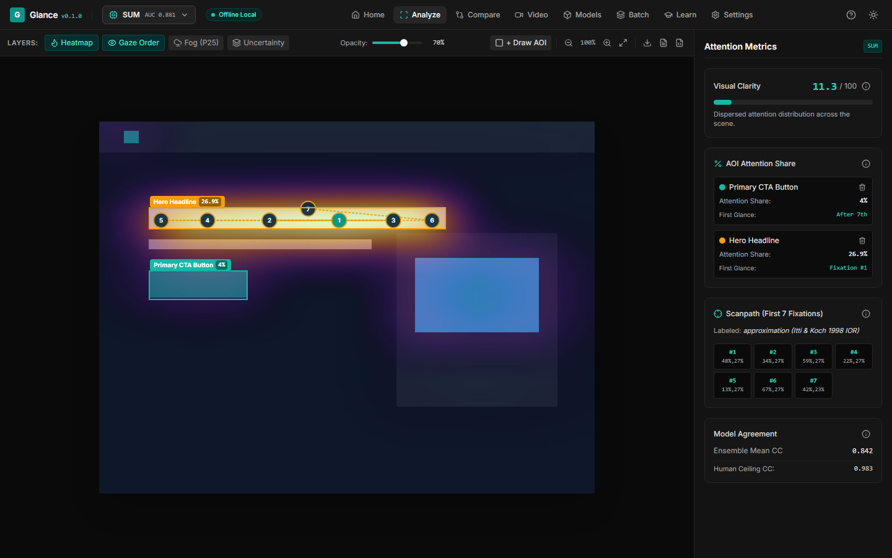
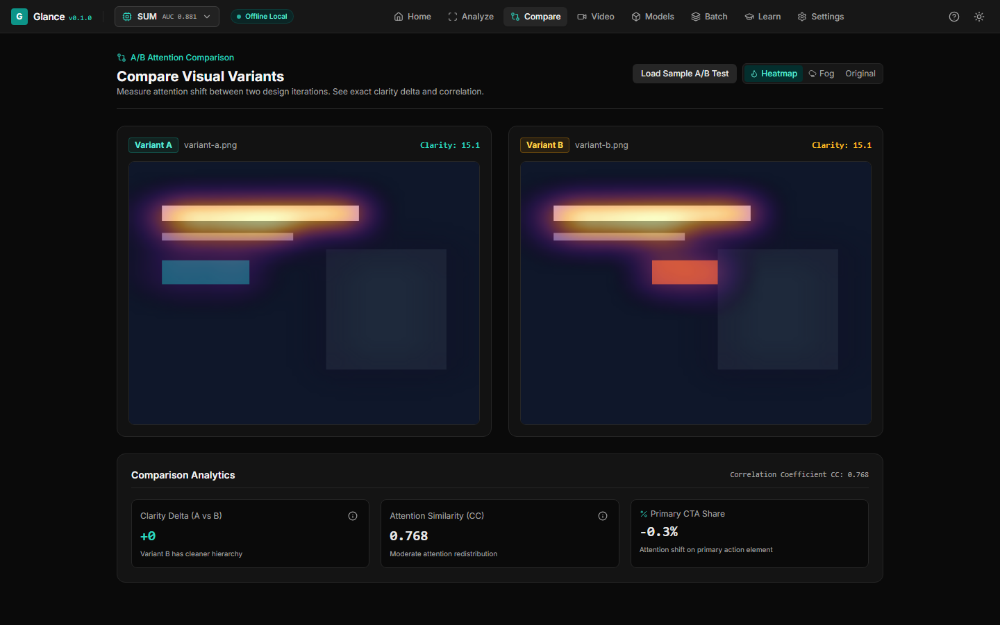
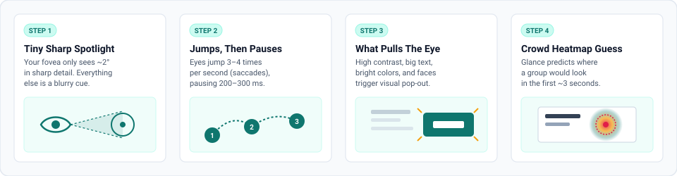
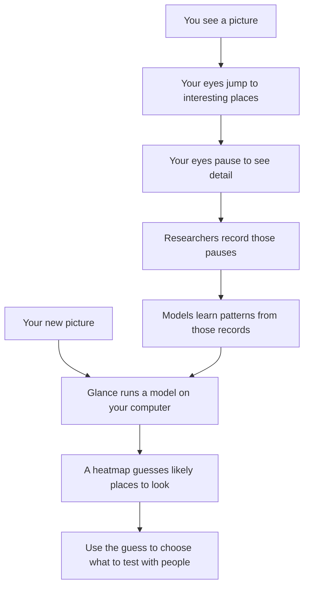
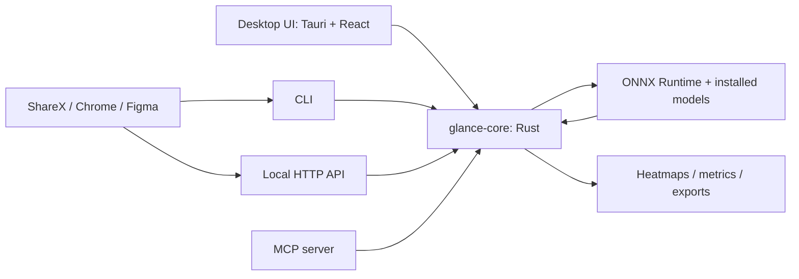
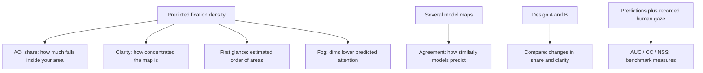

<p align="center">
  <picture>
    <source media="(prefers-color-scheme: dark)" srcset="assets/readme/banner-dark.svg">
    
  </picture>
</p>

<p align="center">
  <strong>Free, open source desktop attention heatmap and saliency prediction (predictive eye tracking): see what gets the first glance in ~3 seconds, processed completely on your computer.</strong>
</p>

Looking for a free, open-source alternative to Attention Insight, Neurons Predict, Brainsight or Feng-GUI? [See the comparisons](https://cgsudo.github.io/glance-attention/compare/).

<p align="center">
  <a href="https://github.com/CGSudo/glance-attention/releases"></a>
  <a href="https://github.com/CGSudo/glance-attention/actions/workflows/ci.yml"></a>
  <a href="LICENSE"></a>
  
  
  
</p>

<p align="center">
  <a href="https://cgsudo.github.io/glance-attention/download.html"><strong>Download</strong></a> ·
  <a href="https://cgsudo.github.io/glance-attention/how-it-works.html"><strong>How It Works</strong></a> ·
  <a href="https://cgsudo.github.io/glance-attention/science.html"><strong>Science &amp; Limits</strong></a> ·
  <a href="https://cgsudo.github.io/glance-attention/integrations.html"><strong>Integrations</strong></a> ·
  <a href="https://cgsudo.github.io/glance-attention/compare/"><strong>Compare Tools</strong></a>
</p>

---

### What Glance does

- **100% Local &amp; Private**: Runs installed ONNX models directly on your CPU/GPU via Tauri 2 and Rust. Your images never leave your machine—no accounts, no cloud dependencies, zero telemetry.
- **Transparent Empirical Metrics**: Every clarity score and attention-share percentage shows its exact mathematical formula and peer-reviewed benchmark (AUC / CC against MIT300). No unverified "94% emotion/memory" marketing claims.
- **One Core, Flexible Front Doors**: Use the desktop GUI, run batch operations via the headless CLI, bind the local HTTP API (`127.0.0.1:7878`), or connect AI coding assistants through the native Model Context Protocol (MCP) server.

---

### Product Overview

<table align="center" width="100%">
  <tr>
    <td width="50%" align="center" valign="top">
      <a href="app/ui/screenshots/analyze-1440.png">
        
      </a>
      <br>
      <sub><b>Analyze</b>: Local saliency heatmaps, scanpath fixation order (1→7), AOI draw tool, and clarity score explanations.</sub>
    </td>
    <td width="50%" align="center" valign="top">
      <a href="app/ui/screenshots/compare-1440.png">
        
      </a>
      <br>
      <sub><b>Compare</b>: Side-by-side A/B design variants with per-AOI attention share deltas and correlation coefficients.</sub>
    </td>
  </tr>
</table>

---

### How It Works

<p align="center">
  
</p>


**Start** with [GitHub Releases](https://github.com/CGSudo/glance-attention/releases). Windows + macOS. Download models once, then analyze offline.


## Install

| Platform | When release artifacts are available |
|---|---|
| Windows | Download the Windows installer from the project's GitHub Releases, run it, then open Glance. |
| macOS | Download the macOS disk image from GitHub Releases, open it, then move Glance to Applications. Unsigned builds may trigger Gatekeeper; confirm the source before using System Settings > Privacy & Security > Open Anyway. |

Installers are unsigned. Model downloads require the separately published `models-v1` release assets. Code license is MIT. Model licenses are separate.

## 30-second quick start

After installation and the first model download (excluded from this walkthrough):

1. Drop a screenshot into Glance.
2. Select an installed model; inspect the heatmap and draw an area around your main message.
3. Check its predicted attention share. Change one design element, compare versions, then export an overlay.

The walkthrough is a guide, not a measured performance claim. Test comprehension or conversion with people.

## How your eye works, and how Glance guesses



Sharp central vision covers roughly 2 degrees; eyes make about 3–4 saccades per second, with fixations around 200–300 ms. These approximate descriptions of human vision are not timings measured by Glance.

## Architecture



The desktop UI calls `glance-core` through Tauri commands. Enable **Glance > Open in background server** for integrations while the app stays open. The shared-engine API binds to `127.0.0.1:7878` and requires the bearer token in `<config_dir>/glance/token` (`%APPDATA%` on Windows, `~/Library/Application Support` on macOS).

## What each score means



AOI means area of interest. Higher clarity does not establish a better design; agreement does not establish correctness. Gaze order uses peak picking with inhibition of return when no scanpath model is available, labeled **approximation**. [Read formulas and limits](docs/science.html).

## Honest accuracy

| MIT/Tübingen benchmark reference | AUC | CC | NSS |
|---|---:|---:|---:|
| DeepGaze IIE | 0.8829 | 0.8242 | 2.5265 |
| Human gold standard | 0.9341 | 0.9828 | Not supplied |

Source: [MIT/Tübingen saliency benchmark](https://saliency.tuebingen.ai/). These supplied reference values are not a benchmark of Glance or its exported ONNX models; exact leaderboard row/protocol is TODO-verify. DeepGaze IIE is reference/user-import only under SPEC's license policy.

Commercial “92–96% accuracy” figures can express a ratio to a human ceiling: for example, 83% / 90% ≈ 92%. That does not mean “right 92% of the time.” Check each vendor's metric, dataset and denominator. Different metrics and datasets cannot be ranked by percentages alone.

Predictions cover early free viewing, roughly the first 3 seconds. Tasks, reading, culture, individual differences and unusual images can change attention. Glance does not infer emotions, memory, comprehension, purchases or actual gaze from a screenshot.

## MCP agent setup

Requires an installed CLI with `glance mcp` support. Target configurations; runtime integration is not verified here. Use an absolute executable path when the client cannot find `glance` on PATH.

Claude Desktop (`claude_desktop_config.json`) or Cursor (`.cursor/mcp.json`): merge this server into your existing configuration; do not replace other servers.

```json
{
  "mcpServers": {
    "glance": { "command": "glance", "args": ["mcp"] }
  }
}
```

Claude Code:

```sh
claude mcp add --transport stdio glance -- glance mcp
```

Tools: `analyze_image`, `compare_images`, `list_models`. Review image paths before sharing them with a client. Local inference does not control what an external MCP client sends to its own service.

CLI alternative:

```sh
glance analyze screenshot.png --model unisal --out out/ --json
```

[Integration setup and privacy boundaries](docs/integrations.html).

## Credits

CGSudo build the application around published attention research. [CITATIONS.md](CITATIONS.md) records papers, models, datasets, licenses and planned use, with BibTeX. SUM/TranSalNet: MIT code; UNISAL: Apache-2.0 code. Verify weights and dependencies before redistribution. EyeFormer and DeepGaze IIE: user-import only under the specification; no bundled assets.

## License

Glance's own code: MIT. TODO-verify: add the repository's full MIT license text before publishing code; this documentation is not a substitute for that file. Papers, datasets and model assets retain their own terms.

## Documentation maintenance

Publish GitHub Pages from `main` / `docs` at [the documentation site](https://cgsudo.github.io/glance-attention/). See [publication notes](docs/NOTES.md). Plain HTML with no build step.

```sh
node docs/check-links.mjs
```

## Maintainers

Build the desktop app from the repository root. Install Rust stable with Cargo on PATH and Node.js 24.

```sh
npm --prefix app/ui ci
npm --prefix app ci
cd app
npx tauri build
```

`beforeBuildCommand` builds the UI and CLI sidecar. For workspace checks from a fresh checkout, run `node app/prepare-sidecar.mjs` and `npm --prefix app/ui run build` first. Bundles land under `target/release/bundle/`. Pushing a `v*` tag builds unsigned Windows NSIS/MSI and macOS arm64/x64 DMGs into a draft GitHub Release.

Model weights stay outside git. Export the ONNX files, confirm `models/registry.json` checksums, create the `models-v1` GitHub Release, then upload locally with authenticated GitHub CLI.

```powershell
powershell -NoProfile -File tools/release/upload-models.ps1
```

The script expands `models/*.onnx` and runs `gh release upload models-v1` against `CGSudo/glance-attention`. Publish that release before testing network installs. Existing assets require explicit removal before replacement.
